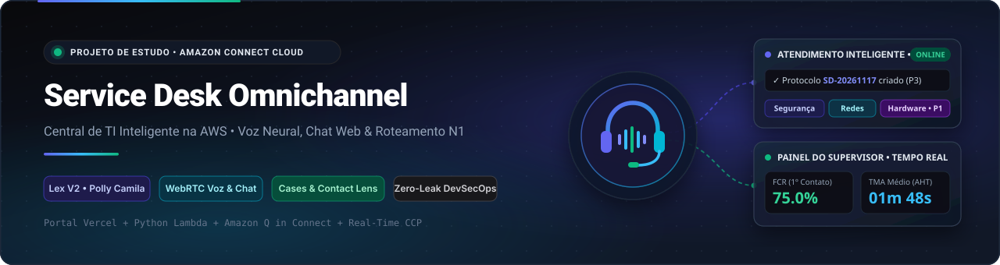
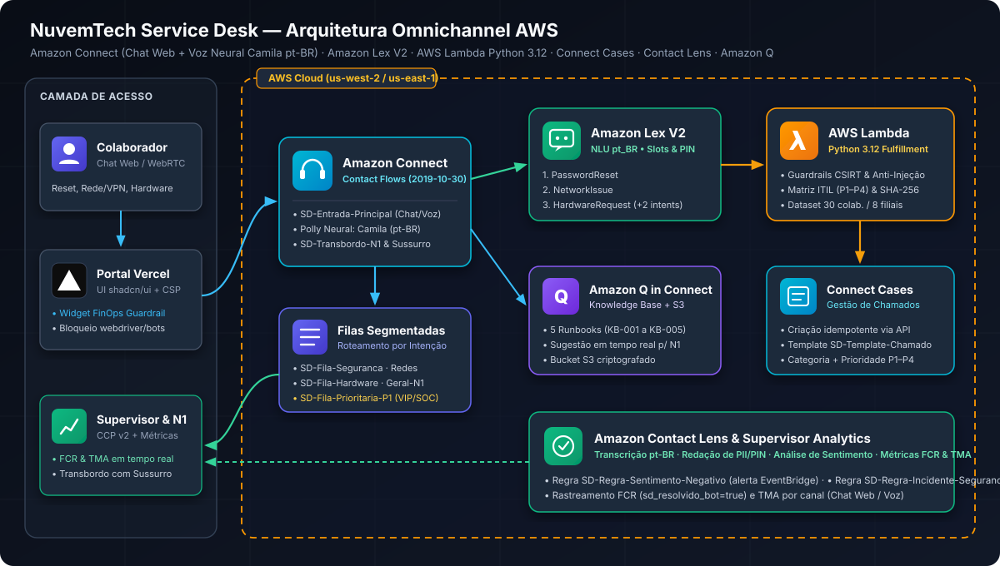
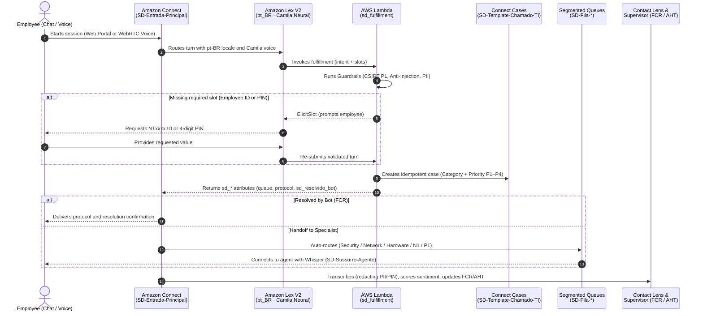
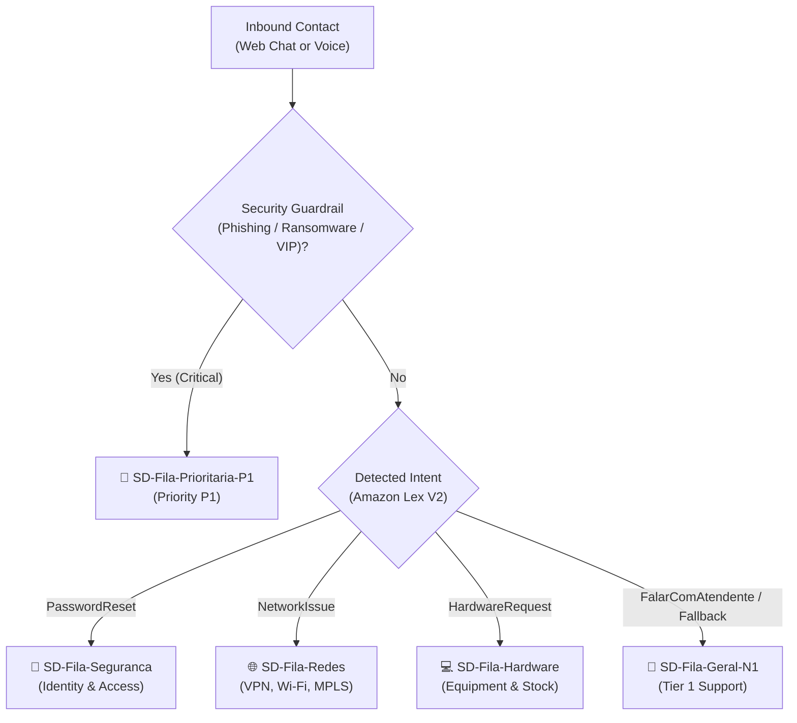
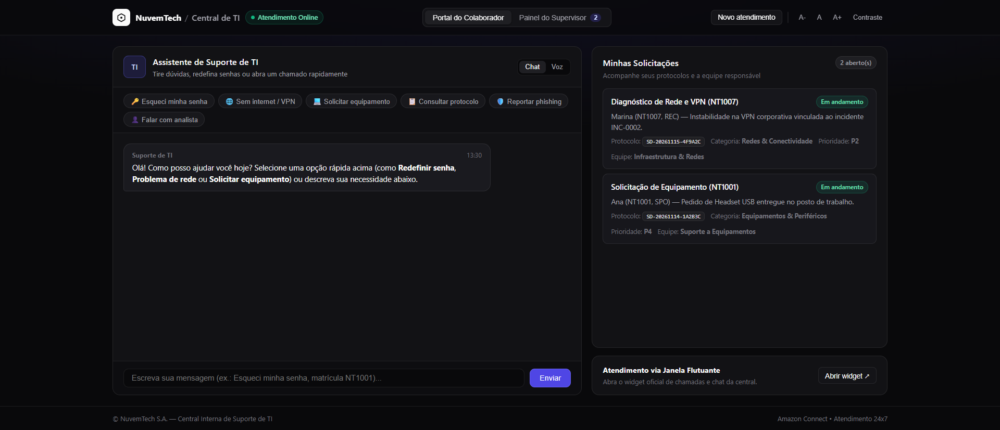
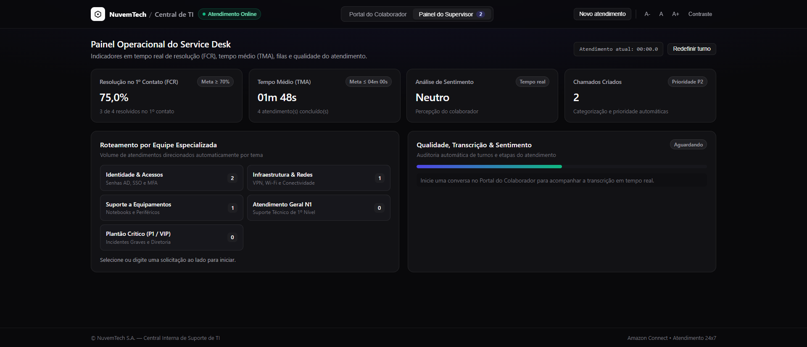
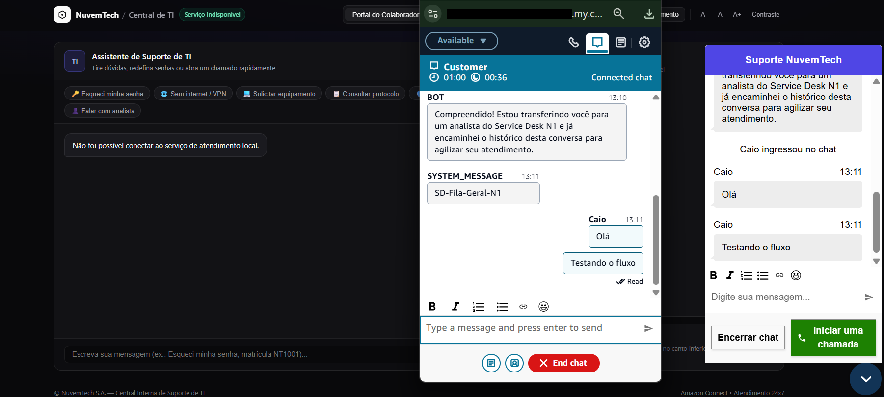
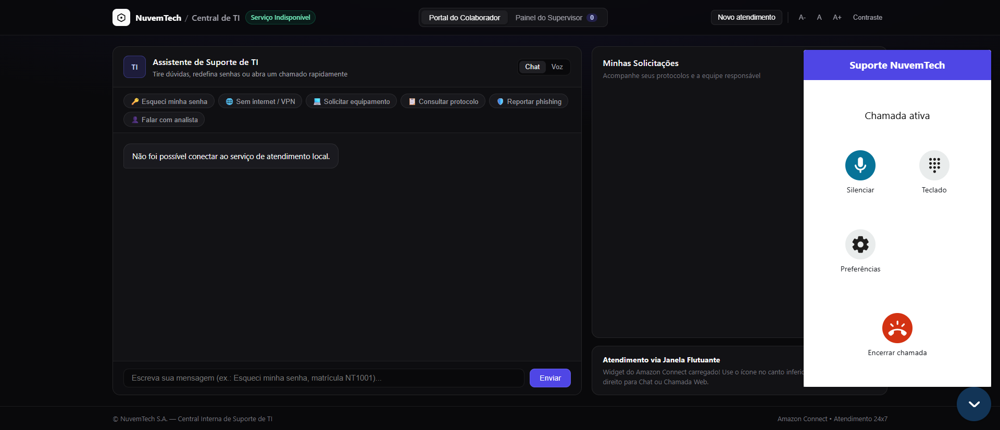
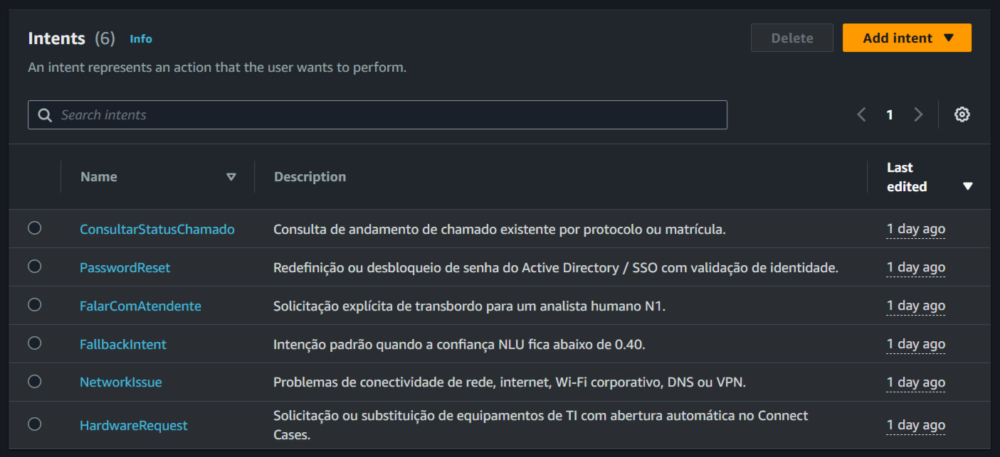
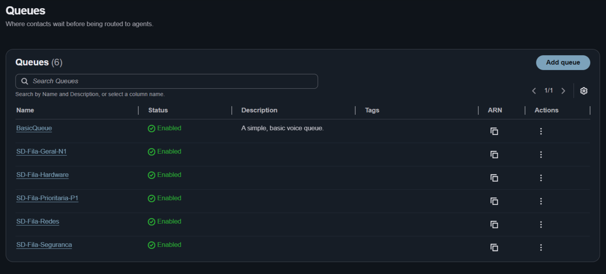

<p align="center">
  
</p>

<h1 align="center">NuvemTech Service Desk — Amazon Connect Omnichannel Study</h1>

<p align="center">
  <a href="https://amazon-connect-service-desk-case2.vercel.app/"></a>
  <a href="https://github.com/caiocesarti/amazon-connect-service-desk-case2/actions/workflows/ci.yml"></a>
  
  
  
  
  
  
</p>

<p align="center">
  <strong>🌐 Language:</strong> <strong>English</strong> · <a href="README.md">Português (BR)</a>
</p>

> **⚠️ Disclaimer — Study & Portfolio Project (Not Production-Ready):**  
> This repository is strictly for **hands-on learning and portfolio demonstration**, built to practice integrating **Amazon Connect**, **Amazon Lex V2**, **AWS Lambda (Python 3.12)**, **Connect Cases**, and **Contact Lens**. **It is NOT ready for production use:** it relies on a static fictional dataset (*NuvemTech Soluções S.A.* in `data/service_desk.json`), has no persistent database, no enterprise authentication (SSO/IAM Identity Center), and no production-grade hardening or SLA guarantees.

Laboratory prototype of an **Omnichannel Internal IT Service Desk (Web Chat & Portuguese Neural Voice)** paired with a demonstration web portal (*Employee Portal* and *Supervisor Dashboard*) and local validation/automation tooling. **Live Lab Demo (Vercel):** [amazon-connect-service-desk-case2.vercel.app](https://amazon-connect-service-desk-case2.vercel.app/).

---

## 1. AWS Architecture Overview



---

## 2. Conversational Flow & Omnichannel Sequence (Mermaid)



### Routing Decision Tree by Intent & Severity



---

## 3. Implemented Deliverables (1:1 Mapping)

| # | Expected Deliverable | Technical Implementation in Repository |
|---|---|---|
| **1** | **Amazon Connect Flow with $\ge$ 3 Amazon Lex Intents (`PasswordReset`, `NetworkIssue`, `HardwareRequest`)** | Contact Flow [`SD-Entrada-Principal.json`](connect/flows/SD-Entrada-Principal.json) integrated with [`lex/bot-export.json`](lex/bot-export.json) (`pt_BR`, neural voice `Camila`, 6 intents, custom slot types in [`lex/slot-types.json`](lex/slot-types.json)), and import bundler [`scripts/gerar_pacote_lex.py`](scripts/gerar_pacote_lex.py). |
| **2** | **Segmented queues per incident category with automated routing** | 5 queues defined in [`connect/recursos.yaml`](connect/recursos.yaml) (`SD-Fila-Seguranca`, `SD-Fila-Redes`, `SD-Fila-Hardware`, `SD-Fila-Geral-N1`, `SD-Fila-Prioritaria-P1`), routing logic in [`lambda/sd_fulfillment/chamados.py`](lambda/sd_fulfillment/chamados.py), and contextual transfer via [`SD-Transbordo-N1.json`](connect/flows/SD-Transbordo-N1.json) + [`SD-Sussurro-Agente.json`](connect/flows/SD-Sussurro-Agente.json). |
| **3** | **Amazon Connect Cases integration (auto-creation, category & priority)** | Idempotent adapter [`lambda/sd_fulfillment/casos.py`](lambda/sd_fulfillment/casos.py) with ITIL priority matrix (`P1`–`P4`) and field template [`connect/cases/template-chamado.json`](connect/cases/template-chamado.json). |
| **4** | **Amazon Contact Lens for transcription & sentiment analysis** | Negative-sentiment rules (EventBridge supervisor alert), real-time P1 detection, PII/PIN redaction, and FCR confirmation rules in [`connect/contact-lens/regras.json`](connect/contact-lens/regras.json). |
| **5** | **FCR & AHT (TMA) metrics visible to supervisors** | Targets and bot containment tracking (`sd_resolvido_bot`) in [`connect/recursos.yaml`](connect/recursos.yaml), live visualization in the **Supervisor Dashboard** ([`landing/index.html`](landing/index.html)), and verification playbook in [`docs/03-testes-e-evidencias.md`](docs/03-testes-e-evidencias.md). |
| **+** | **Additional Lab Engineering Practices** | `shadcn/ui`-inspired portal ([`landing/`](landing/)) with FinOps interaction cap ([`scripts/injetar_widget.py`](scripts/injetar_widget.py)), 5 operational runbooks in [`kb/`](kb/) for Amazon Q in Connect, structured Zero-PII JSON logging, AWS SAM template ([`infra/template.yaml`](infra/template.yaml)), Zero-Leak scanner ([`scripts/verificar_segredos.py`](scripts/verificar_segredos.py)), and CI ([`.github/workflows/ci.yml`](.github/workflows/ci.yml)). |

---

## 4. Repository Structure

```text
amazon-connect-service-desk-case2/
├── .github/workflows/ci.yml            # CI Pipeline: Ruff, Mypy, Zero-Leak, Validators, Pytest >=90%, Gitleaks
├── README.md                           # Project documentation (Portuguese pt-BR)
├── README.en.md                        # Project documentation (English)
├── SECURITY.md                         # DevSecOps Zero-Leak security policy
├── api/index.py                        # Vercel serverless HTTP entrypoint (static UI + /api/config + /api/lex)
├── connect/
│   ├── cases/template-chamado.json     # Amazon Connect Cases custom field schema
│   ├── contact-lens/regras.json        # Transcription, PII redaction, and sentiment alerting rules
│   ├── flows/                          # 4 Contact Flows (schema 2019-10-30 with visual coordinates)
│   └── recursos.yaml                   # Queues, business hours, routing profile, and FCR/AHT targets
├── data/
│   ├── schema/service_desk.schema.json # JSON Schema Draft 2020-12 contract
│   └── service_desk.json               # Simulated dataset (30 employees, 8 branches, 12 HW items, incidents)
├── docs/
│   ├── assets/                         # Header SVG banner and AWS architecture diagram
│   ├── img/                            # Sanitized screenshots from AWS Console, CCP, and Web Portal
│   ├── adr/                            # Architecture Decision Records (ADR-001, ADR-002)
│   ├── 01-arquitetura.md               # Detailed architecture, sd_* contract, and guardrails (pt-BR)
│   ├── 02-passo-a-passo.md             # AWS + Vercel provisioning & FinOps teardown guide (pt-BR)
│   └── 03-testes-e-evidencias.md       # E2E test scenarios (CT-01 to CT-14) and evidence gallery (pt-BR)
├── infra/template.yaml                 # AWS SAM template (Python 3.12 Lambda, least-privilege IAM, 7d logs)
├── kb/                                 # 5 operational articles (KB-001 to KB-005) for Amazon Q in Connect
├── lambda/sd_fulfillment/              # Python 3.12 backend (stdlib + boto3, zero external dependencies)
├── landing/                            # Web Portal (Employee Portal + Supervisor Dashboard)
├── lex/                                # Lex V2 pt_BR bot definition and slot types
├── scripts/                            # DevSecOps automation, packaging, and local lab server
├── tests/                              # Pytest suite (91 tests, 94.94% coverage including api/)
└── vercel.json                         # CSP headers (Amazon Connect, CloudFront, Chime WebRTC) & static build
```

---

## 5. Running and Testing Locally

### Prerequisites
- Python 3.12+

### Step-by-Step

```bash
# 1. Create virtual environment and install dev dependencies
python -m venv .venv
# Windows: .venv\Scripts\activate | Linux/macOS: source .venv/bin/activate
pip install -r requirements-dev.txt
pre-commit install

# 2. Run linter, static typing, Zero-Leak audit, validators, and unit tests (91 tests)
ruff check .
mypy lambda/sd_fulfillment scripts api
python scripts/verificar_segredos.py
python scripts/validar_dataset.py
python scripts/validar_flows.py
pytest

# 3. Start the Local Lab (Web Portal + simulated Python Lambda backend)
python scripts/servir_local.py --porta 8080
```

Open **[http://localhost:8080](http://localhost:8080)** to explore the implemented flows (UI in Portuguese):
1. In the **Portal do Colaborador** (*Employee Portal*), test **`🔑 Esqueci minha senha`** (`PasswordReset` — ID `NT1001`, PIN `4821`), **`🌐 Sem internet / VPN`** (`NetworkIssue` — ID `NT1011`), and **`💻 Solicitar equipamento`** (`HardwareRequest` — ID `NT1001`).
2. Watch sample tickets appear under **Minhas Solicitações** (*My Requests*) with protocol, category, priority, and target queue.
3. Switch to **Painel do Supervisor** (*Supervisor Dashboard*) in the top navigation bar to monitor simulated **FCR (%)**, **AHT (TMA)**, **Team Routing**, and **Transcription & Sentiment** — or click **`▶ Simular fila de atendimentos`** to run all 6 scenarios sequentially.

---

## 6. Lab Evidence (AWS Sandbox + Portal)

> Screenshots captured during testing in an AWS sandbox account (`us-west-2`), integrating the web portal, Amazon Lex V2, Python Lambda, WebRTC voice calls, and live agent handoff to the Contact Control Panel (CCP):

| Employee Portal (`Atendimento Online`) | Supervisor Dashboard (`FCR` & `AHT`) |
|---|---|
|  |  |

| Live Lab Handoff (Widget → CCP) | WebRTC Voice Call (`Web Calling`) |
|---|---|
|  |  |

| Amazon Lex V2 Intents | Segmented Queues in Connect |
|---|---|
|  |  |

See all 9 lab screenshots and validated flows in **[docs/03-testes-e-evidencias.md](docs/03-testes-e-evidencias.md#5-galeria-de-evidências-do-laboratório-aws-sandbox-ccp-e-portal)**.

---

## 7. Additional Documentation

- **[docs/01-arquitetura.md](docs/01-arquitetura.md)** — `sd_*` session attribute contract, ITIL matrix, and guardrails *(pt-BR)*.
- **[docs/02-passo-a-passo.md](docs/02-passo-a-passo.md)** — Full AWS + Vercel provisioning and FinOps teardown guide *(pt-BR)*.
- **[docs/03-testes-e-evidencias.md](docs/03-testes-e-evidencias.md)** — End-to-end test scenarios (`CT-01` to `CT-14`) and evidence gallery *(pt-BR)*.
- **[SECURITY.md](SECURITY.md)** — DevSecOps Zero-Leak policy *(pt-BR)*.

---

## 8. License

Distributed under the [MIT](LICENSE) License.
