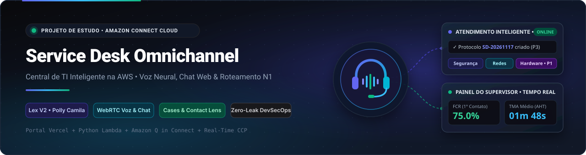
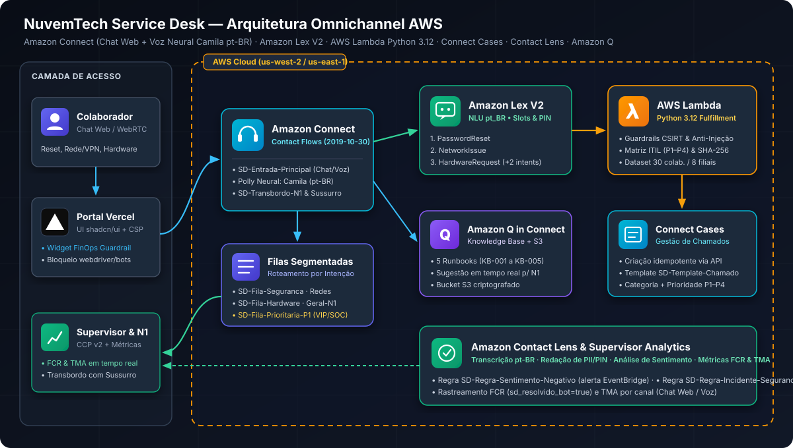
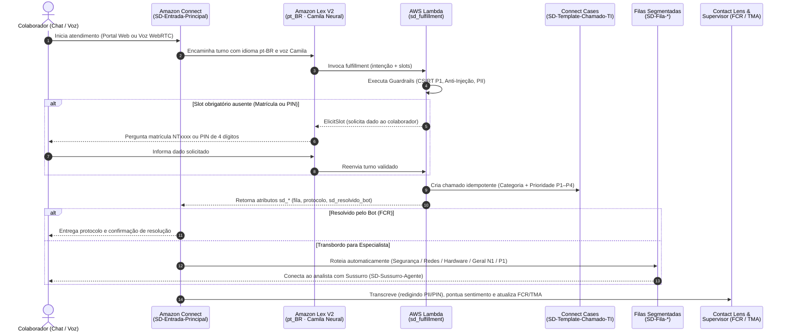
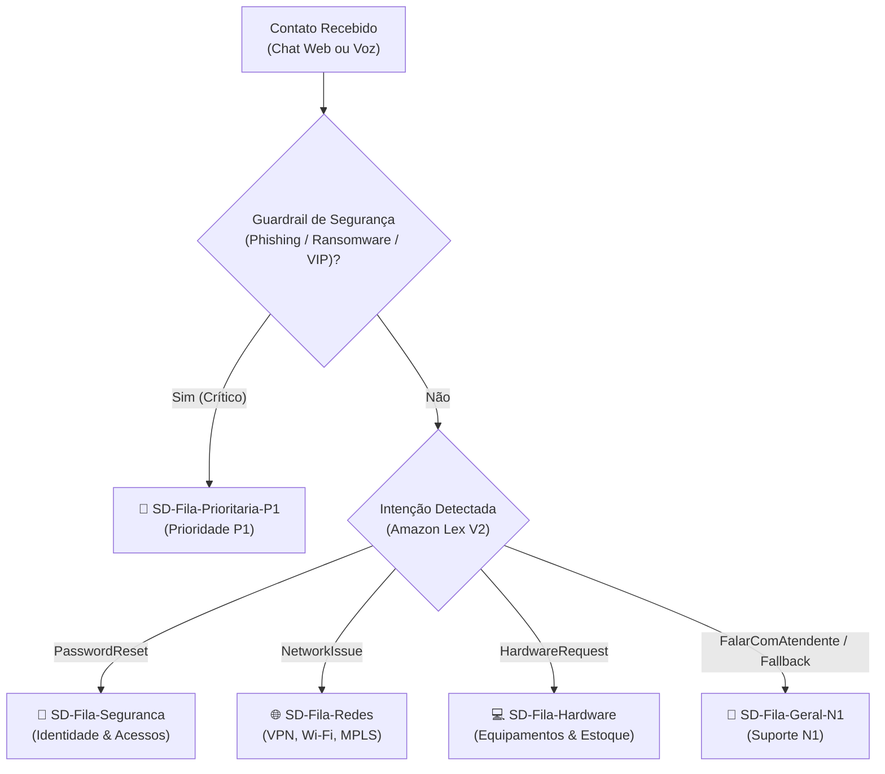
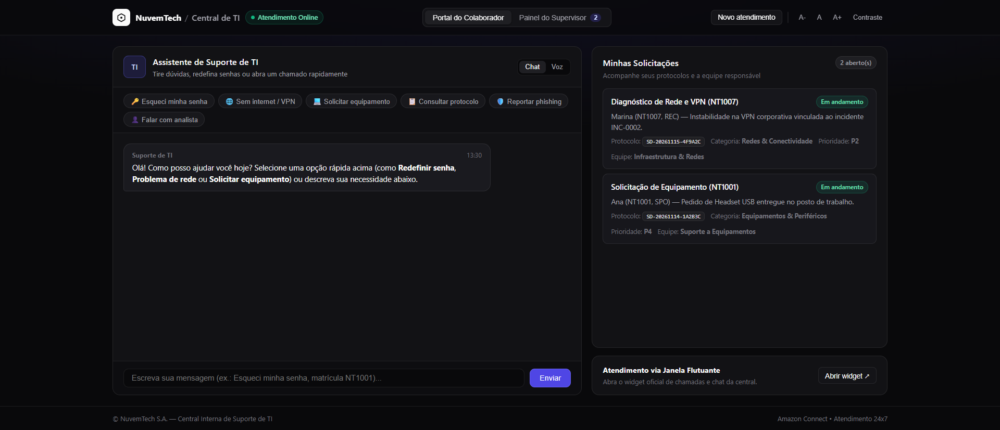
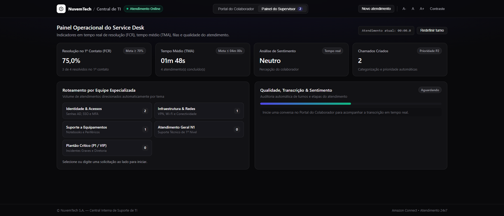
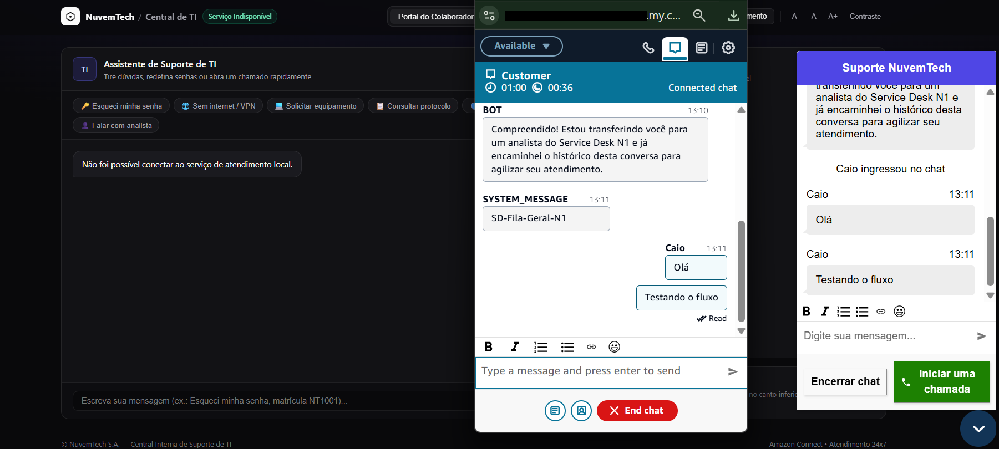
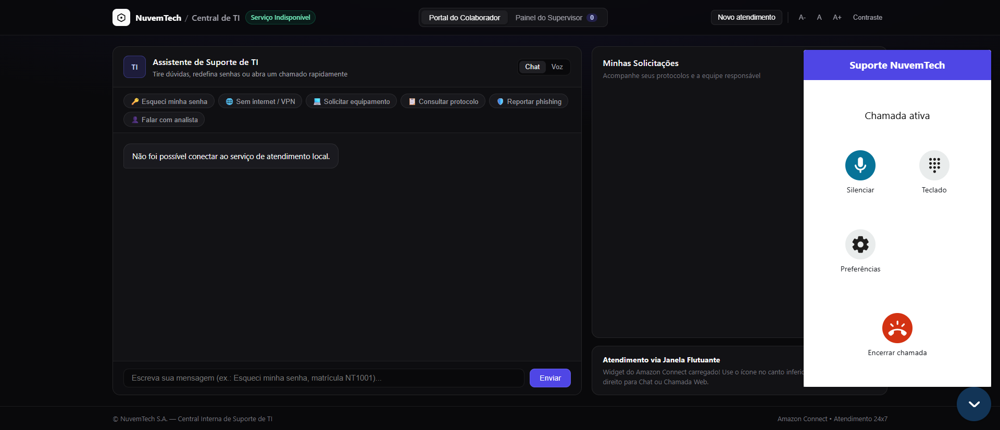
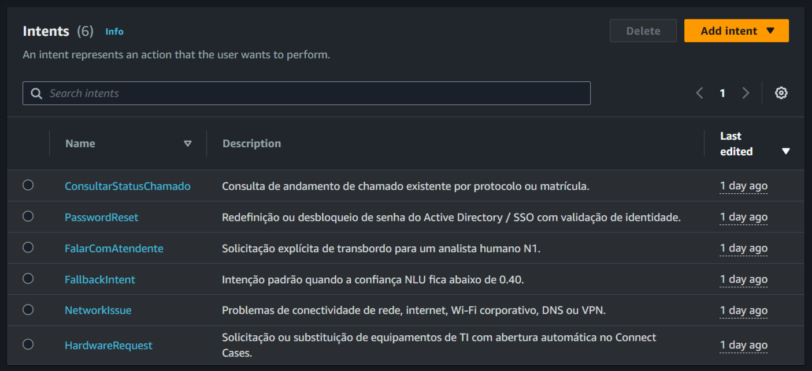
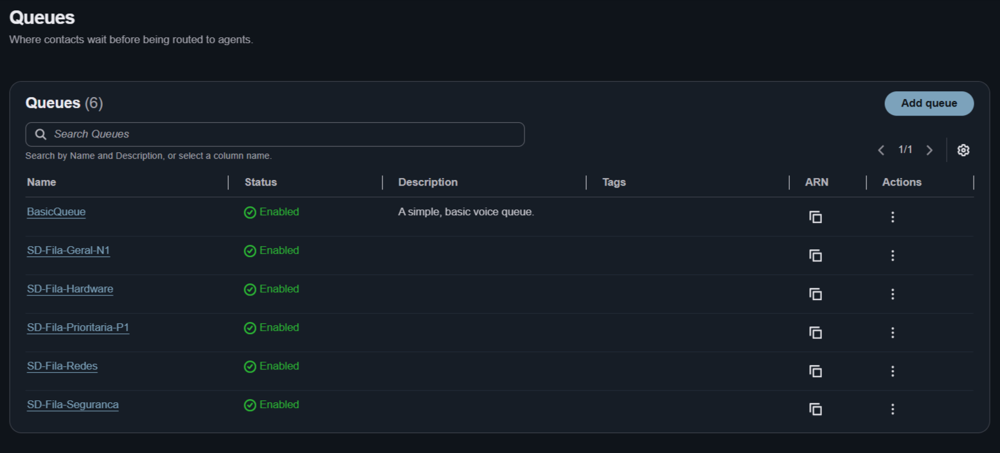

<p align="center">
  
</p>

<h1 align="center">NuvemTech Service Desk — Estudo Amazon Connect Omnichannel</h1>

<p align="center">
  <a href="https://amazon-connect-service-desk-case2.vercel.app/"></a>
  <a href="https://github.com/caiocesarti/amazon-connect-service-desk-case2/actions/workflows/ci.yml"></a>
  
  
  
  
  
  
</p>

<p align="center">
  <strong>🌐 Idioma / Language:</strong> <strong>Português (BR)</strong> · <a href="README.en.md">English</a>
</p>

> **⚠️ Aviso — Projeto de Estudo (Não pronto para produção):**  
> Este repositório tem finalidade **exclusivamente educacional e de portfólio**, criado para praticar a integração entre **Amazon Connect**, **Amazon Lex V2**, **AWS Lambda (Python 3.12)**, **Connect Cases** e **Contact Lens**. **Ele NÃO está pronto para uso em produção:** utiliza um conjunto de dados estático fictício (*NuvemTech Soluções S.A.* em `data/service_desk.json`), sem banco de dados persistente, sem autenticação corporativa (SSO/IAM Identity Center), sem criptografia de sessão produtiva ou hardening de infraestrutura para carga real.

Protótipo de laboratório de um **Service Desk Interno de TI Omnichannel (Chat Web & Voz pt-BR)** acompanhado de uma interface web de demonstração (*Portal do Colaborador* e *Painel do Supervisor*) e scripts de automação/validação local. **Demo do laboratório (Vercel):** [amazon-connect-service-desk-case2.vercel.app](https://amazon-connect-service-desk-case2.vercel.app/).

---

## 1. Arquitetura AWS da Solução



---

## 2. Fluxo Conversacional & Sequência Omnichannel (Mermaid)



### Árvore de Decisão de Roteamento por Intenção e Criticidade



---

## 3. Entregáveis Implementados (Matriz 1:1)

| # | Entregável Esperado | Implementação Técnica no Repositório |
|---|---|---|
| **1** | **Fluxo no Amazon Connect com $\ge$ 3 intenções no Amazon Lex (`PasswordReset`, `NetworkIssue`, `HardwareRequest`)** | Contact Flow [`SD-Entrada-Principal.json`](connect/flows/SD-Entrada-Principal.json) integrado ao bot [`lex/bot-export.json`](lex/bot-export.json) (`pt_BR`, voz neural `Camila`, 6 intenções e tipos de slots em [`lex/slot-types.json`](lex/slot-types.json)) e pacote de importação gerado por [`scripts/gerar_pacote_lex.py`](scripts/gerar_pacote_lex.py). |
| **2** | **Filas segmentadas por tipo de incidente com roteamento automático** | 5 filas declaradas em [`connect/recursos.yaml`](connect/recursos.yaml) (`SD-Fila-Seguranca`, `SD-Fila-Redes`, `SD-Fila-Hardware`, `SD-Fila-Geral-N1`, `SD-Fila-Prioritaria-P1`), lógica de roteamento em [`lambda/sd_fulfillment/chamados.py`](lambda/sd_fulfillment/chamados.py) e transferência contextual em [`SD-Transbordo-N1.json`](connect/flows/SD-Transbordo-N1.json) + [`SD-Sussurro-Agente.json`](connect/flows/SD-Sussurro-Agente.json). |
| **3** | **Integração com Connect Cases (criação automática, categoria e prioridade)** | Adapter idempotente [`lambda/sd_fulfillment/casos.py`](lambda/sd_fulfillment/casos.py) com matriz de prioridade ITIL (`P1`–`P4`) e schema [`connect/cases/template-chamado.json`](connect/cases/template-chamado.json). |
| **4** | **Contact Lens para transcrição e análise de sentimento** | Regras de sentimento negativo (alerta EventBridge ao supervisor), detecção P1 em tempo real, redação de PII/PIN e confirmação de FCR em [`connect/contact-lens/regras.json`](connect/contact-lens/regras.json). |
| **5** | **Métricas de FCR e TMA disponíveis para o supervisor** | Metas e rastreamento (`sd_resolvido_bot`) em [`connect/recursos.yaml`](connect/recursos.yaml), visualização em tempo real no **Painel do Supervisor** em [`landing/index.html`](landing/index.html) e roteiro de verificação em [`docs/03-testes-e-evidencias.md`](docs/03-testes-e-evidencias.md). |
| **+** | **Recursos Adicionais do Laboratório** | Portal de estudo estilo `shadcn/ui` ([`landing/`](landing/)) com limite de interações FinOps ([`scripts/injetar_widget.py`](scripts/injetar_widget.py)), 5 runbooks em [`kb/`](kb/) para Amazon Q in Connect, scanner [`scripts/verificar_segredos.py`](scripts/verificar_segredos.py) e CI/CD ([`.github/workflows/ci.yml`](.github/workflows/ci.yml)). |

---

## 4. Estrutura do Repositório

```text
amazon-connect-service-desk-case2/
├── .github/workflows/ci.yml            # Pipeline CI: Ruff, Mypy, Zero-Leak, Validações, Pytest >=90% e Gitleaks
├── README.md                           # Documentação principal do projeto (pt-BR)
├── README.en.md                        # English version of the project README
├── SECURITY.md                         # Política DevSecOps Zero-Leak
├── api/index.py                        # Entrypoint HTTP serverless da Vercel (estáticos + /api/config + /api/lex)
├── connect/
│   ├── cases/template-chamado.json     # Template de campos do Amazon Connect Cases
│   ├── contact-lens/regras.json        # Regras de transcrição, redação PII e análise de sentimento
│   ├── flows/                          # 4 Contact Flows (schema 2019-10-30 com layout visual)
│   └── recursos.yaml                   # Filas, horário comercial, routing profile e metas FCR/TMA
├── data/
│   ├── schema/service_desk.schema.json # Contrato JSON Schema Draft 2020-12
│   └── service_desk.json               # Dataset simulado (30 colaboradores, 8 filiais, 12 itens HW, incidentes)
├── docs/
│   ├── assets/                         # Banner do header e diagrama SVG da arquitetura AWS
│   ├── img/                            # Capturas sanitizadas do console AWS, CCP e Portal
│   ├── adr/                            # Architecture Decision Records (ADR-001, ADR-002)
│   ├── 01-arquitetura.md               # Arquitetura detalhada, contrato sd_* e guardrails
│   ├── 02-passo-a-passo.md             # Guia de provisionamento AWS + Vercel
│   └── 03-testes-e-evidencias.md       # Roteiro de testes E2E (CT-01 a CT-14) e evidências
├── infra/template.yaml                 # Template AWS SAM (Lambda Python 3.12, IAM least privilege, Logs 7d)
├── kb/                                 # 5 artigos operacionais (KB-001 a KB-005) para Amazon Q in Connect
├── lambda/sd_fulfillment/              # Backend Python 3.12 (stdlib + boto3, zero deps externas)
├── landing/                            # Portal Web (Portal do Colaborador + Painel do Supervisor)
├── lex/                                # Definição do bot pt_BR e tipos de slots
├── scripts/                            # Automação DevSecOps, empacotamento e servidor local do laboratório
├── tests/                              # Suíte Pytest (91 testes, >94% de cobertura incl. api/)
└── vercel.json                         # CSP (Amazon Connect, CloudFront, Chime WebRTC) e saída estática
```

---

## 5. Como Executar e Testar no Laboratório Local

### Pré-requisitos
- Python 3.12+

### Passo a passo

```bash
# 1. Criar ambiente virtual e instalar dependências de desenvolvimento
python -m venv .venv
# Windows: .venv\Scripts\activate | Linux/macOS: source .venv/bin/activate
pip install -r requirements-dev.txt
pre-commit install

# 2. Executar lint, tipagem estática, auditoria Zero-Leak, validações e testes (91 testes)
ruff check .
mypy lambda/sd_fulfillment scripts api
python scripts/verificar_segredos.py
python scripts/validar_dataset.py
python scripts/validar_flows.py
pytest

# 3. Subir o Laboratório Local (Portal Web + Backend Lambda simulado)
python scripts/servir_local.py --porta 8080
```

Acesse **[http://localhost:8080](http://localhost:8080)** para explorar os fluxos implementados:
1. No **Portal do Colaborador**, teste os fluxos **`🔑 Esqueci minha senha`** (`PasswordReset` — matrícula `NT1001`, PIN `4821`), **`🌐 Sem internet / VPN`** (`NetworkIssue` — matrícula `NT1011`) e **`💻 Solicitar equipamento`** (`HardwareRequest` — matrícula `NT1001`).
2. Observe os chamados de exemplo criados em **Minhas Solicitações** com protocolo, categoria, prioridade e fila de destino.
3. Alterne para o **Painel do Supervisor** no topo da barra de navegação para acompanhar os indicadores simulados de **FCR (%)**, **TMA**, **Roteamento por Equipe** e **Transcrição & Sentimento** — ou clique em **`▶ Simular fila de atendimentos`** para executar os 6 cenários em sequência.

---

## 6. Evidências do Laboratório (AWS Sandbox + Portal)

> Capturas obtidas durante os testes em conta sandbox da AWS (`us-west-2`), integrando o portal web, o Amazon Lex V2, a Lambda Python, chamadas WebRTC e o recebimento no Contact Control Panel (CCP):

| Portal do Colaborador (`Atendimento Online`) | Painel do Supervisor (`FCR` & `TMA`) |
|---|---|
|  |  |

| Transbordo no Lab (Widget → CCP) | Chamada de Voz WebRTC (`Web Calling`) |
|---|---|
|  |  |

| Intenções no Amazon Lex V2 | Filas Segmentadas no Connect |
|---|---|
|  |  |

Veja todas as 9 capturas do laboratório em **[docs/03-testes-e-evidencias.md](docs/03-testes-e-evidencias.md#5-galeria-de-evidências-do-laboratório-aws-sandbox-ccp-e-portal)**.

---

## 7. Documentação Complementar

- **[docs/01-arquitetura.md](docs/01-arquitetura.md)** — Contrato de atributos `sd_*`, matriz ITIL e guardrails.
- **[docs/02-passo-a-passo.md](docs/02-passo-a-passo.md)** — Provisionamento completo na AWS (`S3` → `Lambda` → `Lex V2` → `Connect` → `Vercel`).
- **[docs/03-testes-e-evidencias.md](docs/03-testes-e-evidencias.md)** — Casos de teste ponta a ponta (`CT-01` a `CT-14`) e galeria de evidências.
- **[SECURITY.md](SECURITY.md)** — Política DevSecOps Zero-Leak.

---

## 8. Licença

Distribuído sob a licença [MIT](LICENSE).
