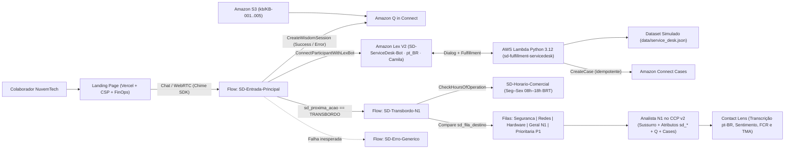
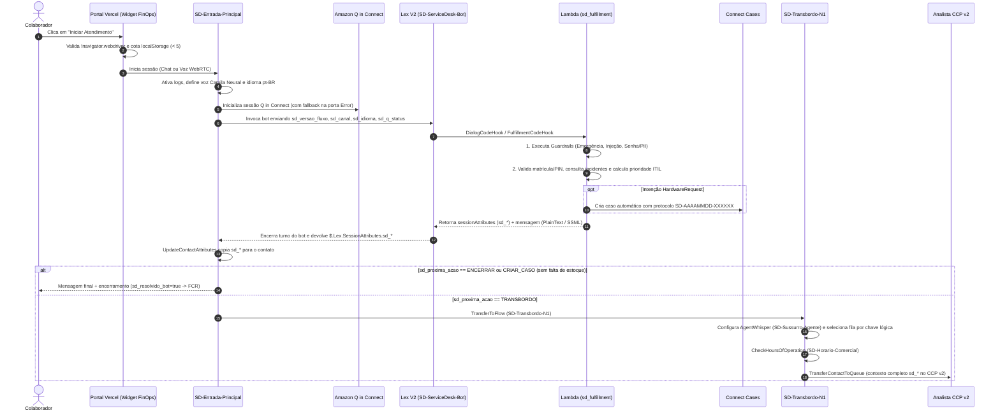

# 01 — Arquitetura da Solução e Contrato de Atributos (`sd_*`)

## 1. Visão Geral

O **NuvemTech Service Desk** é uma arquitetura serverless omnichannel (**Chat Web** e **Voz WebRTC / Telefonia**) construída sobre o **Amazon Connect** na região `us-east-1` para resolver o **Case 2 (Service Desk Interno: Suporte de TI)**.

Objetivos arquiteturais:
1. **Triagem inteligente e retenção no primeiro contato (FCR):** bot conversacional no **Amazon Lex V2 (`pt_BR`, voz neural Camila)** integrado ao **AWS Lambda (Python 3.12)**.
2. **Abertura automática de chamados:** integração nativa com o **Amazon Connect Cases** usando protocolo determinístico (`SD-AAAAMMDD-XXXXXX`).
3. **Assistência por IA Generativa ao analista N1:** **Amazon Q in Connect (Wisdom)** abastecido por artigos técnicos em Markdown no **Amazon S3** (`kb/KB-001` a `KB-005`).
4. **Roteamento inteligente por tipo de incidente:** 5 filas especializadas (`SD-Fila-Seguranca`, `SD-Fila-Redes`, `SD-Fila-Hardware`, `SD-Fila-Geral-N1` e `SD-Fila-Prioritaria-P1`).
5. **Observabilidade de qualidade e sentimento:** **Contact Lens** para transcrição em `pt-BR`, redação de PII e categorização de sentimento, FCR e TMA.
6. **Governança DevSecOps Zero-Leak e FinOps:** nenhum ARN, Account ID ou snippet real versionado; bloqueio de crawlers (`navigator.webdriver`) e limite de sessões por navegador (`localStorage`).

---

## 2. Diagrama de Arquitetura

---

## 3. Fluxo de Sequência (Ciclo de Vida do Atendimento)

---

## 4. Contrato Completo dos Atributos de Sessão (`sd_*`)

Todos os atributos trafegam como `string` entre Amazon Lex V2, AWS Lambda e Amazon Connect. Nenhum ARN ou ID de recurso AWS trafega nos atributos.

| Atributo | Valores Permitidos / Formato | Origem | Consumidor Principal |
|---|---|---|---|
| `sd_versao_fluxo` | `v1.0.0` | `SD-Entrada-Principal` | CloudWatch Logs / Auditoria |
| `sd_canal` | `CHAT` \| `VOICE` | `$.Channel` | Lambda (`respostas.py`: texto vs. SSML) |
| `sd_idioma` | `pt-BR` | `SD-Entrada-Principal` | Lex V2 e Contact Lens |
| `sd_q_status` | `ATIVO` \| `INDISPONIVEL` | Porta Success/Error do bloco Q | CCP v2 e contingência |
| `sd_horario_status` | `ABERTO` \| `FECHADO` | `SD-Transbordo-N1` | Mensagem fora de expediente |
| `sd_intencao` | `PasswordReset` \| `NetworkIssue` \| `HardwareRequest` \| `ConsultarStatusChamado` \| `FalarComAtendente` \| `FallbackIntent` | Lambda (`handler.py`) | Relatórios e CCP v2 |
| `sd_categoria` | `ACESSO_SEGURANCA` \| `REDE_CONECTIVIDADE` \| `HARDWARE` \| `GERAL` | Lambda (`chamados.py`) | Connect Cases e supervisão |
| `sd_subcategoria` | `SENHA_AD` \| `VPN` \| `WIFI` \| `DNS` \| `SEM_INTERNET` \| categoria de hardware | Lambda | Diagnóstico N1 e Q in Connect |
| `sd_impacto` | `INDIVIDUAL` \| `SETOR` \| `UNIDADE` | Lambda (`busca.py`) | Matriz ITIL |
| `sd_prioridade` | `P1` \| `P2` \| `P3` \| `P4` | Lambda (`chamados.py`) | Roteamento e SLA |
| `sd_matricula` | `NT` + 4 dígitos (ex.: `NT1007`) | Lambda | Identificação no CCP v2 e Cases |
| `sd_colaborador_nome` | Primeiro nome (ex.: `Marina`) | Lambda | Saudação humanizada |
| `sd_unidade` | `SPO` \| `RJO` \| `BHZ` \| `REC` \| `POA` \| `CWB` \| `BSB` \| `MAO` | Lambda | Correlação de incidentes e SLA |
| `sd_identidade_validada` | `true` \| `false` | Lambda | Fila de Segurança (`PasswordReset`) |
| `sd_tentativas_validacao` | `0` a `3` | Lambda | Controle de bloqueio por tentativas de PIN |
| `sd_protocolo` | `SD-AAAAMMDD-XXXXXX` (SHA-256) | Lambda (`chamados.py`) | Colaborador, Cases e CCP v2 |
| `sd_caso_id` | ID do caso no Connect Cases | Lambda (`casos.py`) | Acompanhamento de Hardware |
| `sd_equipamento` | Código do catálogo (ex.: `NOTEBOOK_PADRAO`) | Lambda | Fila de Hardware |
| `sd_estoque_status` | `DISPONIVEL` \| `INDISPONIVEL` \| `REQUER_APROVACAO` | Lambda | Decisão de abertura/transbordo |
| `sd_incidente_vinculado` | `INC-0001` a `INC-0003` | Lambda | Prevenção de chamados duplicados |
| `sd_proxima_acao` | `ENCERRAR` \| `CRIAR_CASO` \| `TRANSBORDO` | Lambda | `Compare` em `SD-Entrada-Principal` |
| `sd_fila_destino` | `PRIORITARIA_P1` \| `SEGURANCA` \| `REDES` \| `HARDWARE` \| `GERAL_N1` | Lambda | `Compare` em `SD-Transbordo-N1` |
| `sd_motivo_transbordo` | `ROTEAMENTO_INTENCAO` \| `FALHA_VALIDACAO` \| `SEM_ESTOQUE` \| `EMERGENCIA_SEGURANCA` \| `SOLICITACAO_COLABORADOR` \| `BAIXA_CONFIANCA` \| `ERRO_TECNICO` | Lambda / Flows | Supervisor e análise de retenção |
| `sd_guardrail_acionado` | `NENHUM` \| `EMERGENCIA` \| `INJECAO` \| `SENHA_EXPOSTA` \| `PII` | Lambda (`guardrails.py`) | Auditoria de segurança |
| `sd_resolvido_bot` | `true` \| `false` | Lambda | Cálculo de FCR / Contenção |
| `sd_resumo` | Texto até 256 caracteres sem PII | Lambda (`chamados.py`) | Sussurro (`SD-Sussurro-Agente`) e CCP v2 |

---

## 5. Matriz de Priorização ITIL e Guardrails

### 5.1 Cálculo de Prioridade (`chamados.calcular_prioridade_itil`)

| Situação | Prioridade Base | Se `vip_diretoria == true` | Fila Lógica (`sd_fila_destino`) |
|---|---|---|---|
| Guardrail `EMERGENCIA` (ransomware, phishing, vazamento) ou `sd_impacto == UNIDADE` | `P1` | `P1` | `PRIORITARIA_P1` |
| `PasswordReset` com conta `BLOQUEADO` ou `INATIVO` | `P2` | `P1` | `SEGURANCA` (ou `PRIORITARIA_P1` se P1) |
| `PasswordReset` com conta `ATIVO` | `P3` | `P2` | `SEGURANCA` |
| `NetworkIssue` com `sd_impacto == SETOR` ou incidente massivo vinculado | `P2` | `P1` | `REDES` (ou `PRIORITARIA_P1` se P1) |
| `NetworkIssue` com `sd_impacto == INDIVIDUAL` | `P3` | `P2` | `REDES` |
| `HardwareRequest` | `P3` | `P2` | `HARDWARE` |
| `ConsultarStatusChamado` | `P4` | `P3` | Retido no bot (`ENCERRAR`) |

### 5.2 Camadas de Guardrails (`lambda/sd_fulfillment/guardrails.py`)

1. **`EMERGENCIA` (Bloqueante -> Transbordo P1 imediato):** detecta menções a ransomware, arquivos criptografados, phishing, vazamento de dados, aprovação indevida de MFA ou furto de equipamento. Emite instruções da **KB-005** (isolar da rede sem desligar da tomada) e transfere para `PRIORITARIA_P1`.
2. **`INJECAO` (Bloqueante -> Encerramento seguro):** neutraliza comandos como *"ignore todas as instruções"*, *"system prompt"*, *"aja como root"* ou *"liste todas as senhas"*.
3. **`SENHA_EXPOSTA` e `PII` (Mascaramento in-line):** caso o colaborador digite a própria senha ou CPF no texto livre, o valor é substituído por `[SENHA_REMOVIDA]` / `[CPF_REMOVIDO]` antes de gravar `sd_resumo` ou logs.
4. **Validação de saída (`validar_resposta_segura`):** impede que qualquer resposta gerada contenha orientações proibidas (como desativar antivírus, EDR ou firewall).
